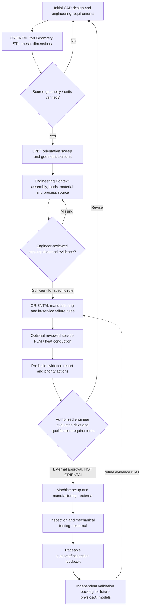

# ORIENTAI — Pre-build engineering assessment architecture
Client review: 5 November 2026 · Virginia Tech / Boeing senior design · **Research prototype**

## Objective and manufacturing role

ORIENTAI provides a **pre-build design/manufacturing decision-support step**: combine an uploaded
STL with engineer-reviewed application requirements and a specified AM process; screen
manufacturability and potential failure mechanisms; explain each concern and corrective
action; and export an auditable report. It does **not** approve a part for aerospace or
manufacturing use and does not calculate a calibrated probability of build or in-service
failure. The current optimization algorithms compare **geometric LPBF orientation metrics**,
not as-built strength, true support toolpaths or global production cost.

## Current implemented capabilities

| Layer | Code | What it actually provides |
|---|---|---|
| STL import | `components/AnalysisProvider.tsx` | Local file upload, SHA-256 fingerprint, IndexedDB workspace |
| Mesh identity | `lib/stl-mesh-audit.ts` | Triangle connectivity, open/non-manifold edges, disconnected shells, small tessellation edges, surface area; closed single-shell volume |
| LPBF geometry | `lib/orientation-engine.ts`, `lib/part-screening.ts` | Deterministic finite candidate search, envelope, down-facing area, support **proxy**, plate-contact heuristic |
| Application intake | `lib/copilot-context.ts`, `lib/engineering-evidence.ts` | Part-hash-scoped assembly/document context; engineer-reviewed source excerpts |
| Source-approved numeric inputs | `lib/engineering-parameter-binding.ts` | Extract numeric candidates but require explicit sign/direction and independent approval before solver transfer |
| LPBF process-window review | `lib/lpbf-process-quality.ts`, `components/v2/ProfessionalProcessPanel.tsx` | Compare engineer-entered planned values with specific sourced ranges; optional energy-density **diagnostic** |
| Engineering simulation | Existing advanced numerical components | Idealized service-load linear elasticity and steady conduction; separate coarse LPBF research heat-flow worker |
| **Unified assessment** | **`lib/prebuild-assessment.ts`** | Auditable manufacturing and service rule findings, evidence basis, required input, next action, explicit unknowns |
| Manufacturing lifecycle | `lib/manufacturing-process-flow.ts` | Design through external printing/testing/feedback, with phase status and ownership |
| Outcome feedback | `lib/part-inspection-feedback.ts`, `components/v2/usePartFeedback.ts` | Local engineer-entered build/test records, linked to a screening ID; **not model training** |
| Engineering report | `lib/copilot-review-pdf.ts` | Part-specific PDF dossier: geometry, two real STL wireframes, process/evidence provenance, rule register, actions, workflow and feedback |
| Optional AI | `app/api/engineering-copilot/route.ts` | Consent-gated external **explanation only**, when authorized model available; never STL bytes |
| Study UI | `/copilot/workbench` | Three-stage study with resizable CAD pane and stage-local workflow tabs |

## Rule evidence and priority semantics

- `critical`: measured/declared screen requires repair or boundary review before any release consideration
- `high`: geometric or context concern requiring engineering investigation
- `medium`: support/orientation/tessellation review concern
- `information`: important missing input or unassessed physical mechanism; **not low risk**
- `observed`: measured STL topology
- `screened`: a deterministic geometry or declared process-boundary rule
- `unassessed`: no supported, validated physical calculation or required data

Examples:
- Open/nonmanifold edges: measured topology; model input repair may be mandatory.
- Multiple disconnected shells: measured topology; verify intentional assemblies/load paths.
- Smallest mesh edge below 0.2 mm: *tessellation* flag only, **not wall thickness**. Requires units confirmed.
- Overhang fraction over 25%: configurable/heuristic review trigger, **not a defect likelihood**.
- Envelope and entered process-window violations: compare user-entered bounds; do not predict porosity or cracking.
- Service loads/allowables missing: cannot calculate required strength or recommend lightweighting safely.
- Lack of fusion, keyhole, hot cracking, print-induced residual stress, fatigue: remain unassessed
  until appropriate verified data and physical/statistical models are introduced.

The qualitative rule engine **never returns an invented risk percentage**. Selecting a rule for down-facing geometry can
activate the corresponding real STL overhang overlay; unvalidated crack/porosity locations are not rendered.

## Inputs required for meaningful functional performance review

Part identity; material specification and condition; assembly drawing and revision;
connection/fixture locations; verified force and moment magnitudes/directions;
service temperature and environmental effects; actual acceptance criteria and material
allowables; and required safety factors. Source keywords alone never supply FEM inputs.
The existing research structural and heat-conduction workers cannot establish
as-built fatigue properties, true thermomechanical distortion, porosity or the
best build orientation for service strength.

## Build setup and machine setting optimization

No generic LPBF parameter preset is treated as safe. Engineering must enter an
actual machine, alloy/condition, parameter-set ID, source revision, and planned
laser power, scan speed, hatch spacing and layer thickness with sourced min/max
bounds. Single-axis range checks do not verify the combined process window.
Volumetric energy density is displayed **as a diagnostic only**. Qualified
printing speed, density and quality optimization would require a machine/material
dataset, measured part outcomes and an independently validated joint process model.

## External AI, data handling and security

The workbench's local deterministic evaluation runs without the ARC model key.
Optional external explanation is **off by default**, visible only if a configured
model provider reports availability, and requires a user checkbox to send a
message, engineer-entered context and **reviewed excerpts only**. Binary STLs,
PDFs and raw unreviewed documents are not forwarded by the workbench.
The endpoint treats reference material as untrusted and disallows invented
simulation outcomes. A missing/failed provider returns local guidance.
Data in browser IndexedDB/localStorage is not a certified controlled-data vault;
do **not** upload controlled Boeing drawings, source documents or other restricted
technical data to this public prototype.

## Validating with real evidence

For the November 19 client review, demonstrate:
1. Import an STL and verify actual scale / mesh information.
2. Run current candidate orientation screening and show measured overhang/support proxies.
3. Attach source context and review engineering inputs; never silently infer service loads.
4. Show separated **manufacturing** and **in-service** failure scenarios and evidence quality.
5. Compare real machine process values only against reviewed engineer-supplied limits.
6. Highlight a real geometric overhang rule directly on the STL (not a predicted defect).
7. Export the full evidence dossier and show the manufacturing process flow.
8. Optionally record a real inspection/test result against a specific pre-build finding.

Before calling this predictive, establish ground-truth prints with measured defects,
real process logs, test specimens, build-to-build splits, error bars,
false-positive/false-negative analysis, calibration and independent
held-out validation. Until then the correct description remains **rule-based
pre-build failure-mechanism screening**.

## Test suites and release

- Unit regressions: `npm test` (including `tests/prebuild-assessment.test.ts`,
  `tests/part-inspection-feedback.test.ts`, `tests/mesh-audit.test.ts`).
- TypeScript: `npm run typecheck`.
- Production build: `npm run build`.
- Browser: `npm run test:e2e` (including `tests/browser/professional-workbench.spec.ts` and
  `tests/browser/professional-prebuild.spec.ts`).
- Deploy workbench from **feature/frontend-mockup-rebuild-20261105**, keep
  `main` and teammate branches intact until source review and passing tests.
